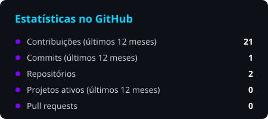
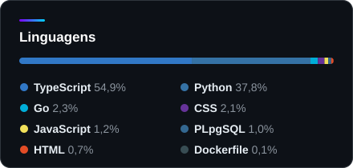

  
  
  
  

### Sobre

Sou fundador da [eSoluções](https://esolu.com.br), onde construo produtos e sistemas sob medida que unem software e IA para resolver problemas reais de negócio, do atendimento ao fechamento de vendas. Atuo do front-end ao deploy e, se um processo pode ser automatizado, ele vai ser.

<!-- FEATURED:START -->
### Produtos e trabalhos selecionados

| Produto | O que é | Stack |
| --- | --- | --- |
| [**eSolu Chat**](https://esolu.com.br/pt/produtos/esolu-chat) | Plataforma de atendimento multicanal (WhatsApp, Instagram e Facebook) com agentes de IA, CRM e relatórios |  |
| [**Camellium**](https://esolu.com.br/pt/produtos/camellium) | Suíte jurídica modular: gestão de escritório, calculadoras, chat e agente de IA para advogados | `Python` `TypeScript` |
| [**Vellumi**](https://esolu.com.br/pt/produtos/salao-ai) | Sistema para salões de beleza com agenda, fichas, caixa e atendente de IA que marca horários pelo WhatsApp | `TypeScript` `JavaScript` `NestJS` `Prisma` `Redis` |
| [**Agentes de IA comercial**](https://esolu.com.br/pt/servicos/agentes-ia-comercial-juridico) | Equipes comerciais com IA que atendem, qualificam e fecham negócios 24/7 |  |
<!-- FEATURED:END -->

### Impacto da plataforma eSolu

<table>
  <tr>
    <td align="center"><h3>18 mi+</h3>mensagens processadas</td>
    <td align="center"><h3>930 mil+</h3>conversas atendidas</td>
    <td align="center"><h3>150 mil+</h3>conversas conduzidas por IA</td>
    <td align="center"><h3>5.000+</h3>contratos fechados por IA</td>
  </tr>
</table>

### O que eu faço

- **Produtos SaaS com IA**: do conceito ao produto rodando com clientes pagantes
- **Agentes de IA e automação**: atendimento, qualificação e vendas no WhatsApp e redes sociais
- **APIs e integrações**: conectando sistemas, canais e serviços de terceiros
- **Infraestrutura e deploy**: aplicações estáveis, observáveis e fáceis de manter

### Stack

<!-- STACKS:START -->
<table>
  <tr><td><b>Linguagens</b></td><td></td></tr>
  <tr><td><b>Front-end</b></td><td></td></tr>
  <tr><td><b>Back-end</b></td><td></td></tr>
  <tr><td><b>Dados</b></td><td></td></tr>
  <tr><td><b>Infra &amp; DevOps</b></td><td></td></tr>
  <tr><td><b>Testes</b></td><td></td></tr>
  <tr><td><b>Ferramentas</b></td><td></td></tr>
</table>
<!-- STACKS:END -->

### No GitHub

  
  

<!-- PROJECTS:START -->

<!-- PROJECTS:END -->

### Contato

Tem um processo que poderia ser um sistema, ou um sistema que precisa evoluir? Vamos conversar: [willyam@esolu.com.br](mailto:willyam@esolu.com.br) · [esolu.com.br](https://esolu.com.br)
