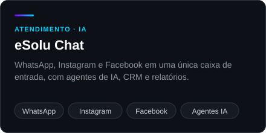
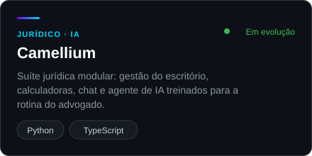
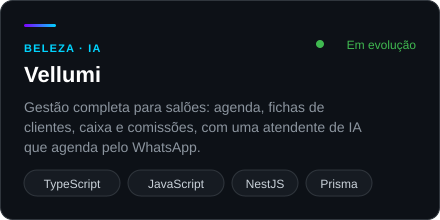
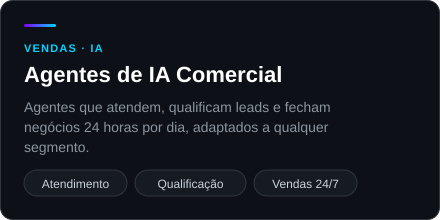

  
  
  

  
  
  
  

### Sobre

Fundador da [eSoluções](https://esolu.com.br). Crio produtos SaaS e sistemas sob medida que combinam software e inteligência artificial para resolver problemas reais de negócio, do primeiro atendimento ao contrato assinado.

Trabalho de ponta a ponta, da arquitetura ao deploy, com uma regra simples: se um processo pode ser automatizado, ele vai ser.

<!-- FEATURED:START -->
### Produtos

  
  
  
  

<!-- FEATURED:END -->

### Impacto

### O que eu faço

- **Produtos SaaS com IA**: da ideia ao produto em produção, com clientes pagantes
- **Agentes de IA e automação**: atendimento, qualificação e vendas no WhatsApp, Instagram e Facebook
- **Apps, APIs e integrações**: web e mobile, conectando sistemas, canais e serviços de terceiros
- **Infraestrutura e deploy**: aplicações estáveis, monitoradas e fáceis de manter

### Stack

<!-- STACKS:START -->
<table>
  <tr><td><b>Linguagens</b></td><td></td></tr>
  <tr><td><b>Front-end</b></td><td></td></tr>
  <tr><td><b>Back-end</b></td><td></td></tr>
  <tr><td><b>Dados</b></td><td></td></tr>
  <tr><td><b>Infra &amp; DevOps</b></td><td></td></tr>
  <tr><td><b>Testes</b></td><td></td></tr>
  <tr><td><b>Ferramentas</b></td><td></td></tr>
</table>
<!-- STACKS:END -->

### Atividade no GitHub

  
  

<!-- PROJECTS:START -->

<!-- PROJECTS:END -->

### Vamos conversar

Tem um processo que poderia virar sistema, ou um sistema que precisa evoluir? Me chame em [willyam@esolu.com.br](mailto:willyam@esolu.com.br) ou conheça a [eSoluções](https://esolu.com.br).
